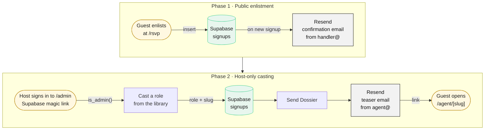

# The Onyx Protocol

A spy-themed murder-mystery party platform. Guests enlist through a classified-dossier invite, and the hosts cast each of them a secret agent identity, delivered by email as a private dossier.

**Live:** [www.theonyxprotocol.xyz](https://www.theonyxprotocol.xyz)

---

## What it does

The Onyx Protocol runs a party in two phases.

**1. Public enlistment.** Guests open the invite, a typewriter-decrypt briefing revealed step by step, and enlist with their name and email. They see a "MISSION ACCEPTED" confirmation and receive a confirmation email. No role is assigned yet.

**2. Host-only casting.** The hosts sign in to a private dashboard, pick a role for each guest from an editable role library, tailor it (cover story, secret motive, ally, rival, a personal storyline), and send it. The guest receives an email with a link to their own dossier page, an unguessable URL laid out as a classified personal file.

## Features

- **Two-phase guest flow:** open enlistment first, deliberate casting later, so hosts can balance the cast before anyone gets a role.
- **Magic-link admin auth** via Supabase Auth, restricted to an allowlist of host emails.
- **Role library with copy-on-cast:** casting copies a role onto the guest, so editing or deleting a library role never changes someone already cast. A codename can only be held by one guest at a time.
- **Transactional email** through Resend on a custom domain: an enlistment confirmation and a dossier teaser email.
- **Unguessable dossier URLs:** each guest's page lives at `/agent/<codename>-<random hex>`, generated server-side with a cryptographic RNG.
- **COVERT / DAYLIGHT themes:** a dark terminal look and an aged-paper look. The choice persists per viewer and is applied before first paint, so there's no flash of the wrong theme.
- **PERSONAL FILE dossier layout:** subject-photo box, file data, labelled role sections, a CSS barcode and a threat-assessment readout. The stats are derived deterministically from the codename, so each agent always shows the same profile with no data entry.
- **Stale-dossier tracking:** a database trigger records when a guest's role is edited, and the dashboard flags anyone whose dossier changed after it was emailed.

## Tech stack

| Layer | Technology |
| --- | --- |
| Framework | Next.js (App Router, Server Components, Server Actions) + TypeScript |
| Database & auth | Supabase: Postgres, Row Level Security, Auth (magic links via `@supabase/ssr`) |
| Email | Resend, sending from a verified custom domain |
| Hosting | Vercel |
| Styling | Hand-authored CSS with design tokens; no CSS framework or component library |

## Security model

Security is enforced by the database, not just the UI.

- **Row Level Security on every table.** `signups`, `dossiers` and `admins` all have RLS enabled. With only the public anon key, nothing can be read or written.
- **Admin access runs as the signed-in user.** Every dashboard read and write uses a Supabase client built from the anon key plus the host's session cookie, never the service-role key. RLS policies built on an `is_admin()` function decide what that user can see and change, so even a signed-in non-admin who reaches an admin page gets zero rows back.
- **The allowlist is enforced twice.** The app checks it in the admin layout (non-admins see "CLEARANCE REVOKED" and no data), and the database checks it again in every policy. The allowlist itself lives in one place, the `admins` table.
- **Privileged keys stay on the server.** The Supabase service-role key is used only for the public enlistment insert and the public dossier read. It and the Resend API key are read only in modules that import `server-only`, so the build fails if either is ever imported into client code. Neither appears in the browser bundle.
- **Race-safe role assignment.** A partial unique index guarantees a codename belongs to at most one cast guest, so two concurrent casts can't collide even if they pass the app-level check at the same moment.
- **Unguessable, revocable dossier links.** Dossier slugs carry 40 bits of randomness and are only served for cast guests. Un-casting a guest clears the slug, which retires the link.

## Architecture



<sub>Green: Supabase (Postgres + RLS + Auth) · Grey: Resend (email) · Gold: guest and host touchpoints</sub>

- **Guest writes** (enlistment) and the **public dossier read** run on the server with the service-role key.
- **Every host action** (casting, the role library, sending) runs as the signed-in user, so Row Level Security and `is_admin()` decide what's allowed.
- **Emails** are sent server-side through Resend, from a verified custom domain.

## Running locally

### 1. Install

```bash
git clone <this-repo-url>
cd onyx-protocol
npm install
```

### 2. Environment variables

Copy the example file and fill in real values:

```bash
cp .env.example .env.local
```

| Variable | Purpose |
| --- | --- |
| `NEXT_PUBLIC_SUPABASE_URL` | Supabase project URL (**Project Settings → API**) |
| `NEXT_PUBLIC_SUPABASE_ANON_KEY` | Supabase anon (public) key |
| `SUPABASE_SERVICE_ROLE_KEY` | Supabase service-role key. **Secret, server-only.** Never give it a `NEXT_PUBLIC_` prefix. |
| `RESEND_API_KEY` | Resend API key. **Secret, server-only.** |
| `EMAIL_FROM_HANDLER` | Sender for enlistment confirmations, e.g. `"The Handler <handler@your-domain>"` |
| `EMAIL_FROM_AGENT` | Sender for dossier emails, e.g. `"The Onyx Protocol <agent@your-domain>"` |
| `NEXT_PUBLIC_SITE_URL` | Base URL used to build dossier links in emails, e.g. `http://localhost:3000` locally |

`.env.local` is git-ignored. For deployment, add the same variables to your Vercel project. The sender addresses must be on a domain you've verified in Resend.

### 3. Database

In the Supabase dashboard, open **SQL Editor** and run the files in `supabase/` **in this order**:

| # | File | What it does |
| --- | --- | --- |
| 1 | `schema.sql` | Creates the `signups` and `dossiers` tables, the codename uniqueness index, and enables RLS |
| 2 | `seed.sql` | Inserts 12 starter roles into the role library |
| 3 | `admins.sql` | Creates the `admins` allowlist, the `is_admin()` function and the admin-only policies on `signups` |
| 4 | `casting.sql` | Adds the admin-only policies on `dossiers` (plus in-place upgrade columns for older databases) |
| 5 | `sending.sql` | Ensures `signups.sent_at` exists for dossier-send tracking |
| 6 | `edit-tracking.sql` | Adds `signups.role_edited_at` and the trigger that powers stale-dossier warnings |

Files 3–6 are idempotent and safe to re-run.

**Set your hosts.** `admins.sql` seeds the allowlist with the hosts' emails. Edit it to your own addresses before running it, or manage the table afterwards:

```sql
insert into admins (email) values ('host@example.com');   -- lowercase
delete from admins where email = 'old.host@example.com';
```

### 4. Supabase Auth configuration

Magic-link sign-in needs these settings in the Supabase dashboard:

1. **Authentication → URL Configuration**
   - **Site URL:** your production URL, e.g. `https://www.theonyxprotocol.xyz`
   - **Redirect URLs:** add your local and production origins and their callbacks:
     - `http://localhost:3000`
     - `http://localhost:3000/auth/callback`
     - `https://<your-production-domain>`
     - `https://<your-production-domain>/auth/callback`
2. **Authentication → Providers → Email:** make sure the Email provider is enabled.

Supabase's built-in auth email is rate-limited on the free tier (a few emails per hour), which is fine for a handful of hosts. Open the magic link in the same browser you requested it from.

### 5. Run

```bash
npm run dev      # http://localhost:3000
npm run build    # production build
npm run lint
```

Then:

- Open `/` for the invite and `/rsvp` to enlist.
- Sign in at `/admin/login` with an allowlisted email to manage signups, the role library and casting.

---

Built as a one-off, bespoke event platform, with the security of a production app and the presentation of a classified file.
